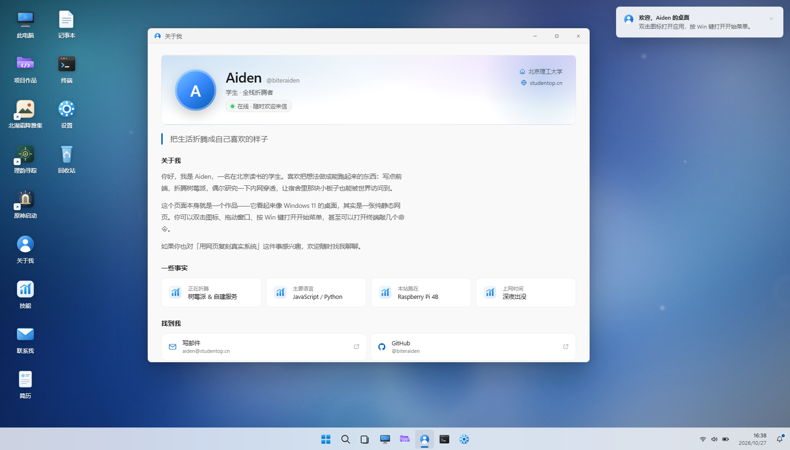
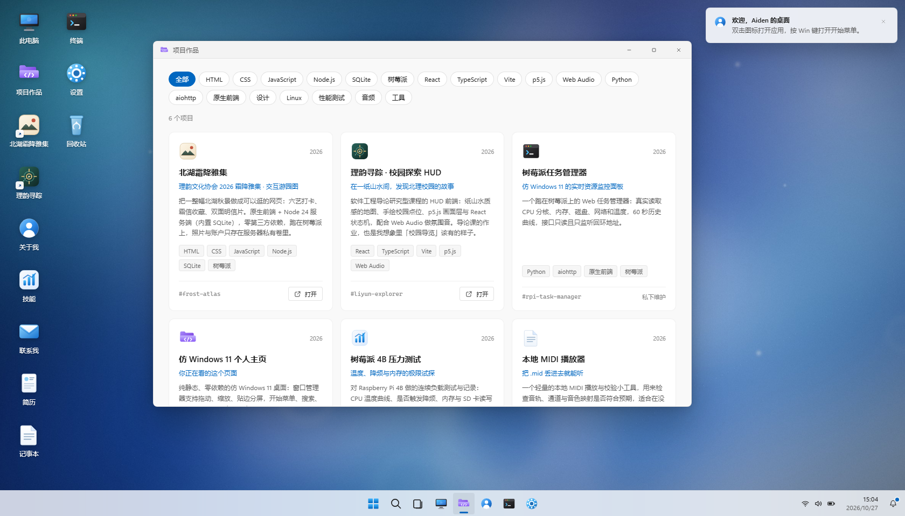

# studentop.cn · 集中开发工作区

个人主页是原生 Windows 风格网页桌面，锁屏由同源私密 Node 服务校验；理韵寻踪、校园入场与体素校园是三个独立 Vite 应用，另在校园应用中保留原版开场独立入口。交互与安全设计见 [10月28日修订](<docs/REVISION-20261028.md>)；主页、校园与体素的发布见 [发布记录](docs/RELEASE-20261028.md)，理韵定位与账号的后续发布见 [融合发布记录](docs/PR2-LOCATION-RELEASE-20261028.md)。这些是历史发布证据，后续改动仍须重新验收和授权发布。升级范围见 [本地升级计划](docs/UPGRADE-PLAN.md)，团队日常操作见 [贡献指南](CONTRIBUTING.md)。

## 本地启动（推荐入口）

最新本地开发加入[理韵活动一览](apps/liyun-explorer/docs/activity/QA.md)和[桌面任务管理器窗口](docs/TASK-MANAGER.md)。活动由左下入口打开；任务管理器复用既有回环监控，通过桌面会话保护的同源只读接口读取，不增加启动器服务或自动创建隧道。这些改动尚未部署到树莓派。

2026-10-29 的 AidenOS 主页已由所有者当次授权发布，实际版本、检查范围和回滚点见[发布收据说明](docs/AIDENOS-RELEASE-20261029.md)。其他应用继续沿用各自已有 release。

前端启动需要 Node.js **22.12+**；包含账号 API 的完整开发环境推荐统一使用 **Node.js 24**（本机已验证 v24.22.0）。以下命令从仓库根目录执行。三个应用有各自的依赖和锁文件，不是 npm workspace，也不是另一个 DeepSeek Harness 服务。

每个应用按自己的锁文件安装依赖；已有依赖无需重装。只查看主页时可以使用 --site-only，不要求应用依赖已安装：

~~~powershell
npm --prefix apps/liyun-explorer ci
npm --prefix apps/genshin-start ci
npm --prefix apps/liangxiang-cloudwalk ci
~~~

~~~powershell
# 只检查目录、Node / SQLite 能力和各应用本地 Vite；不安装、不监听、不读写数据库
node tools/dev-workspace.mjs --check
# 同时启动主页、账号 API 和三个独立 Vite 应用（共5个服务）
node tools/dev-workspace.mjs
# 只看主页时不要求任何Vite应用依赖已安装
node tools/dev-workspace.mjs --site-only
~~~

| 服务 | 固定本地地址 | 内容 |
| --- | --- | --- |
| 个人主页 | <http://127.0.0.1:8899/> | 仅 [site](site/) 的公开 HTML 与静态资源 |
| 理韵账号 API | <http://127.0.0.1:8787/api/health> | 启动器托管的 Node / SQLite 后端；理韵前端通过同源 `/api` 访问 |
| 理韵寻踪 | <http://127.0.0.1:5174/> | React / TypeScript / Vite / p5.js |
| 校园入场（保留 genshin-start 目录与应用 id） | <http://127.0.0.1:8081/> | 北理工主题轻量 3D 入场，进入理韵 |
| 体素校园 | <http://127.0.0.1:5180/> | 独立体素校园应用；runner id 为 voxel，桌面 id 为 voxel-campus |
| 原神启动（原版独立入口） | <http://127.0.0.1:8081/legacy.html> | 原版天空/柱路/门模型，本地同源解码；未公开部署 |

完整模式先启动账号 API，再启动三个前端，无需额外终端。理韵前端经 Vite 将同源 `/api` 请求代理到内部 8787；浏览器不需要直接访问该端口。API 使用既有 `server/data/` 本地 SQLite，或由 `LIYUN_DATA_DIR` 指定数据目录，不自动重置数据。游客模式仍可使用。配置与测试见[账号 API 说明](apps/liyun-explorer/server/README.md)。

- 五个服务（主页、账号 API 及三个 Vite）只绑定 **127.0.0.1**，端口占用直接失败，不自动换端口，不复用未知服务。**旧 5173、4173 服务与 8080 SSH 转发不可停止、复用或改写。**
- <http://127.0.0.1:8899/__workspace/status> 返回工作区名称、路径指纹、启动实例与五项服务状态；<http://127.0.0.1:8899/__workspace/health> 在本次创建的服务全部就绪、账号 `/api/health` 实际请求成功时返回 200，否则为 503。API 健康请求有超时且不跟随重定向；子进程意外退出则整组退出并清理。同名目录用指纹区分。
- 启动器不提供目录列表，不暴露仓库根、点文件、配置、源码映射或秘密文件；拒绝路径穿越及越界链接。三个 Vite 开发入口限定各自 app 根，不是公网服务器。
- 在启动它的终端按 Ctrl+C，关闭**本次创建**的 Vite、账号 API 与主页 HTTP 服务，并关闭数据库连接；不会按端口或进程名清理外部服务。启动中途失败也清理已创建的服务。父子 IPC 断开时子进程自行退出；强制终止整个终端后的状态仍应由负责人检查。
- 本地桌面中的理韵 / 校园 / 体素校园快捷方式分别使用 5174 / 8081 / 5180；原版开场复用 8081 的 legacy.html，不增加服务。校园本地出口仍为 5174。北湖霜降雅集不在这个工作区中运行，不映射到旧服务。理韵出口与原版既有子域不变；轻量校园/体素的生产路径见下表。
- 不要从仓库根运行通用静态服务器；不要为本仓库另起 DSH Web。正常运行不需要重建已有地图、音乐或字体。

单独启动时：理韵执行 **npm run dev**，账号 API 执行 **npm run server**；校园执行 **npm start**（**npm run dev** 是兼容别名）；体素校园执行 **npm run dev**。先退出自己启动的统一启动器，避免占用相同端口。理韵构建预览固定回环 4174，体素预览固定回环 4180，而非旧 4173。**--site-only 只启动8899，不预检或启动应用与账号 API**；--check不创建服务或打开数据库。

## 目录

~~~text
site/                       静态主页发布源：HTML / CSS / JS / 本地资源
apps/liyun-explorer/         理韵源码与自己的 package-lock
apps/genshin-start/          校园入场源码与自己的 package-lock
apps/liangxiang-cloudwalk/   体素校园源码与自己的 package-lock
qa/                         验收脚本；根目录已有 PNG 均为历史截图
qa/upgrade-20261027/         第一轮历史日志、截图与结果
qa/revision-20261028/        体素接入前历史证据（服务数量为3，不改写）
tools/dev-workspace.mjs      安全本地启动器
deploy/                     部署脚本与配置；仅由获授权的Lead执行
docs/UPGRADE-PLAN.md         V2 范围与验收矩阵
~~~

详见 [应用目录说明](apps/README.md)、[主页说明](site/README.md)、[理韵说明](apps/liyun-explorer/README.md)、[校园入场说明](apps/genshin-start/README.md)。迁移前的工作副本不作为当前源码或服务的依据。

## 内容版本发布与浏览器缓存

正式主页产物不直接上传原始静态目录：先运行 `node tools/build-site.mjs`，再运行 `node tools/build-site.mjs --check dist-site`。内容指纹资源绕开旧同名长缓存，HTML和版本元数据再验证；已打开的桌面只提示升级、不自动刷新，未保存便笺可取消更新。见 [缓存修复与迁移](<docs/CACHE-UPDATES.md>)。首次安装还需配置私密同源认证服务并审核 nginx 模板；已有安装结果见 [发布记录](docs/RELEASE-20261028.md)，新一轮本地运行不能当作新版本已上线的证据。

## 检查与证据

~~~powershell
node --test qa/node-tests.cjs qa/desktop-node-tests.cjs
node --test qa/workspace-api-tests.mjs
node apps/liyun-explorer/scripts/asset-manifest.mjs --check
npm --prefix apps/liyun-explorer test
npm --prefix apps/liyun-explorer run test:server
npm --prefix apps/liyun-explorer run build
npm --prefix apps/genshin-start run build
npm --prefix apps/liangxiang-cloudwalk run build
~~~

第一条只做纯 Node 检查；启动器集成回归使用临时合成门禁、临时数据库与隔离端口，验证五服务启动、Vite 同源账号流程、冲突回滚和退出清理，不影响已有开发服务。素材清单检查可从任意工作目录运行。浏览器验收先加载 **opencli** 技能后执行，详见 [QA 说明](qa/README.md)。兼容旧 CDP 文件名与主要参数，但默认改为回环；错误、异常、失败断言或空目标必须返回非零退出码，不能用“截图生成了”代替业务通过。

体素接入前的[10月28日修订记录](docs/REVISION-20261028.md)及其 QA 保留当时三服务快照，体素接入后的四服务记录见[发布记录](docs/RELEASE-20261028.md)。历史数量与结果不改写；当前新增账号 API 的五服务契约见[QA 说明](qa/README.md)。

[理韵旧 QA 记录](apps/liyun-explorer/docs/QA.md) 引用的 app 内截图与 JSON **没有迁入本仓库**，历史数字不充当本轮证据。根 QA 目录的示例截图也属于旧版，不是当前青玉纸境和校园场景的最终效果：

| 历史主页 | 历史项目窗口 |
| --- | --- |
|  |  |

## 线上地址（以最近发布记录为依据）

| 站点 | 已有地址 |
| --- | --- |
| 主页 / 项目索引 | <https://studentop.cn:14355/> / <https://studentop.cn:14355/projects/> |
| 北湖霜降雅集 | <https://frost.studentop.cn:14355/> |
| 理韵寻踪 | <https://liyun.studentop.cn:14355/> |
| 轻量校园 · 纸境入场 | <https://studentop.cn:14355/campus-entry/> |
| 原神启动原版（保留现有子域根release，不重新分发新legacy包） | <https://genshin.studentop.cn:14355/> |
| 体素校园 | <https://studentop.cn:14355/voxel-campus/> |

轻量校园构建 base 与部署路由为主域的 /campus-entry/；体素校园使用相对 base 支持 /voxel-campus/。远端原神子域根保留既有原版 release，不因本地恢复入口而重新分发许可待核实的新 legacy 包。本地8081根路径仍是轻量校园，/legacy.html 仍是原版，两者与生产路由不能混为一谈。

既有架构为 Raspberry Pi 上 nginx + frp TCP 隧道、TLS SNI 分流；带端口原因见 [公网访问记录](deploy/PUBLIC-ACCESS-STATUS.md)。上述地址对应仓库内的发布记录，不表示每次本地检查都重新验证了公网状态；脚本默认测试回环服务。

## 部署权限

**树莓派的一切部署只能由仓库所有者 AnonymousUser443 本人明确发起。** 历史发布授权不延续到后续开发；AI 执行新一轮部署须获得所有者当次明确授权。普通 git push 只同步代码；发布 workflow 仅接受所有者手动触发。实际服务变更、发布命令及验收须单独记录。

- [部署权限约定](DEPLOYMENT-POLICY.md)
- [贡献说明](CONTRIBUTING.md)
- [项目维护手册](deploy/PROJECTS.md)

历史脚本与记录继续保留，不能将本地启动等同于上线；本地日志不得写入令牌、SSH 凭据、用户隐私或完整环境变量。

## 版权与素材

- 本站原创部分遵循根 [LICENSE](LICENSE)。
- 校园入场保留上游 www-genshin（TEAM.x.y.z / gamemcu）的 [MIT 许可](apps/genshin-start/LICENSE)。旧《原神》素材权利归原权利人；程序化校园造型并非官方数字孪生。差异见 [入场改造说明](apps/genshin-start/DEPLOY-NOTES.md)。
- 理韵课程源码与用户地图 / 音频 / 美术素材应分别核对授权；字体许可及重建条件见 [素材说明](apps/liyun-explorer/docs/ASSETS.md)。
