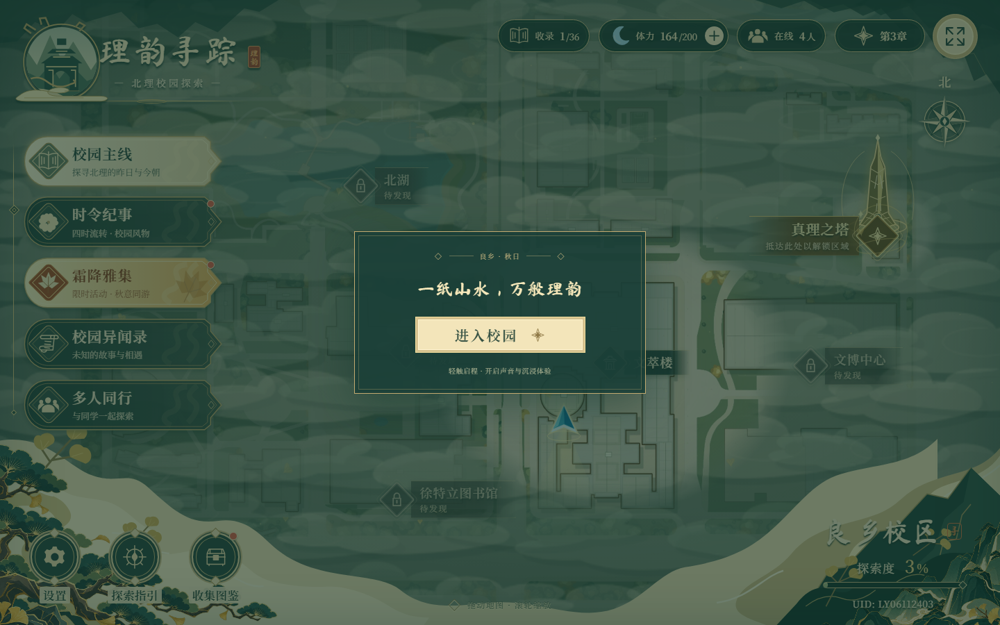
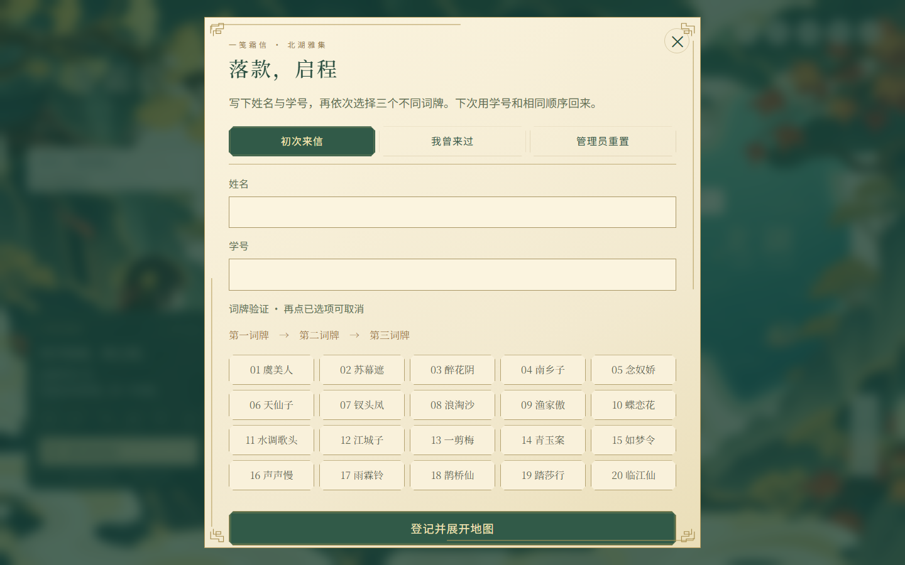

# studentop.cn · 跑在树莓派上的个人站

一个从零自建的个人站点：**仿 Windows 11 的桌面主页** + 三个部署在同一台 Raspberry Pi 4B 上的项目。
没有框架、没有 CDN、没有第三方统计；nginx 只监听回环地址，公网通过 frp 隧道进来，TLS 在树莓派本地终止。

> 在线主页 <https://studentop.cn:14355/> ｜ 项目索引 <https://studentop.cn:14355/projects/>
>
> 为什么地址带 \`:14355\`：当前唯一可用的隧道是普通 TCP 隧道，远程端口固定 14355。
> 免端口的「建站隧道」节点长期宕机，取舍与排障过程见 [deploy/PUBLIC-ACCESS-STATUS.md](deploy/PUBLIC-ACCESS-STATUS.md)。

## ⚠️ 部署权限（重要）

**树莓派上的一切部署，只能由仓库所有者（AnonymousUser443）本人发起。**
其他协作者、团队成员、CI 机器人、AI Agent 一律不要执行部署脚本、不要触发发布 workflow、不要连接这台服务器。

- 完整约定：[DEPLOYMENT-POLICY.md](DEPLOYMENT-POLICY.md)
- 想贡献代码：[CONTRIBUTING.md](CONTRIBUTING.md)（只提 PR，不要部署）

## 站点一览

| 站点 | 地址 | 形态 | 技术栈 |
| --- | --- | --- | --- |
| 个人主页（Win11 桌面） | <https://studentop.cn:14355/> | 纯静态 | 手写 HTML / CSS / ES5 JS，零依赖零构建 |
| 项目索引页 | <https://studentop.cn:14355/projects/> | 纯静态 | 同上，单文件 |
| 北湖霜降雅集 | <https://frost.studentop.cn:14355/> | Node 24 服务 + SQLite，systemd 常驻 | 原生前端 + Node 内置 SQLite，无 npm 依赖 |
| 理韵寻踪 · 校园探索 HUD | <https://liyun.studentop.cn:14355/> | 纯静态（Vite 产物） | React 19 + TypeScript + Vite 7 + p5.js + Web Audio |
| 原神启动（3D 开场） | <https://genshin.studentop.cn:14355/> | 纯静态（Vite 产物） | three.js + xviewer（上游开源项目，见下） |

主页桌面上有三个带小箭头的**快捷方式图标**，双击即在新标签页打开对应项目；「原神启动」播放 3D 登录开场，**开门白光过场后自动进入理韵寻踪**。

## 截图

| 主页桌面 | 项目作品窗口 |
| --- | --- |
|  |  |

| 原神启动 · 登录 | 原神启动 · 开门 |
| --- | --- |
|  |  |

| 理韵寻踪 | 北湖霜降雅集 |
| --- | --- |
|  |  |

## 架构

    Internet
      │  HTTPS（浏览器地址带 :14355）
      ▼
    浮居 frp 节点（北京1号）:14355  ── 纯 TCP 转发，不看域名
      ▼
    frpc（树莓派，type=tcp，local_port=443）
      ▼
    127.0.0.1:443  nginx（Let's Encrypt 证书在树莓派本地终止，按 TLS SNI 分流）
      ├─ SNI studentop.cn / www        → /opt/win11-home/current        主页（静态，原子切 release）
      ├─ SNI frost.studentop.cn        → 127.0.0.1:4173                 北湖霜降雅集（systemd frost-atlas）
      ├─ SNI liyun.studentop.cn        → /opt/projects/liyun/current    理韵寻踪（静态）
      └─ SNI genshin.studentop.cn      → /opt/projects/genshin/current  原神启动（静态）

托管环境：Raspberry Pi 4B / 8GB、Debian 13 (aarch64)、nginx 1.26、Node v24.22（tar 包安装）；
证书走 acme.sh + 阿里云 DNS-01 自动续期；一张证书覆盖 5 个域名（studentop.cn / www / frost / liyun / genshin）。

## 仓库结构

    .
    ├── site/                    仿 Windows 11 桌面主页（部署根目录就是这个目录）
    ├── deploy/                  部署与运维：脚本、nginx 配置、状态文档、各项目部署记录
    │   ├── nginx/               树莓派上实际的 nginx 站点配置与 snippet（含 4 个 server 块）
    │   ├── pi-frost/  pi-liyun/  pi-genshin/   三个项目各自的部署报告与复现脚本
    │   ├── deploy-site.sh       主页原子发布（打包→上传→切软链→自检→失败回滚）
    │   ├── preflight-public.sh  公网入口 8 项自检（frpc / TCP / DNS / 证书 / 四个站点）
    │   ├── PROJECTS.md          三个项目的维护手册（更新、回滚、排查）
    │   └── PI-STATE.md          树莓派当前状态全记录
    ├── qa/                      CDP（Chrome DevTools Protocol）浏览器验收：脚本 + 截图
    ├── tools/                   壁纸/OG 生成器、阿里云 DNS 小工具
    └── apps/
        ├── liyun-explorer/      理韵寻踪源码（React + TS + Vite）
        └── genshin-start/       原神启动源码（已按本部署需求改造，见 DEPLOY-NOTES.md）

## 各项目要点

### 1. 主页 \`site/\`

纯静态的 Win11 桌面复刻：真实可用的窗口管理器（拖动/缩放/贴边分屏/最小化到任务栏）、开始菜单、搜索、日历通知中心、任务视图、7 个内置应用、多壁纸与深浅色主题、URL 深链接（\`?skipLock=1&menu=start&open=about&theme=dark\`）。
内容全在一个文件里改：\`site/assets/js/content.js\`（资料 / 项目 / 技能 / 桌面图标 / 通知）。

### 2. 北湖霜降雅集

协会霜降活动的网页游园图：姓名学号+三词牌登录、六艺打卡收照片、断网可收录后自动补传、双面明信片生成。
服务端用 **Node 24 内置 SQLite** 与零 npm 依赖，数据只存在树莓派私有目录（0700），公网只暴露 HTTPS 前台，管理端只走 SSH 回环。
本仓库只放**部署记录与服务端源码片段**（\`deploy/pi-frost/\`），完整项目与活动数据另处保存。

### 3. 理韵寻踪（\`apps/liyun-explorer/\`）

软件工程导论研究型课程的 HUD 前端：纸山水质感地图、手绘点位、p5.js 画面层、React 状态机与 Web Audio 氛围音。
子域名根目录部署，\`base\` 保持默认 \`/\`；构建 \`npm ci && npm run build\`。

### 4. 原神启动（\`apps/genshin-start/\`）

上游开源项目 **www-genshin**（作者 TEAM.x.y.z，B 站 BV1E8411v7xy，MIT）复刻的《原神》登录开场，本仓库按「给理韵寻踪做一层入场动画」的需求做了改造：

- 开门白光过场结束 → 跳转 <https://liyun.studentop.cn:14355/>（\`src/core/exit.ts\`，可用 \`window.__EXIT_URL__\` 覆盖）
- 兜底：\`?skip=1\` 直跳、左上角「跳过开场」、无 WebGL 时降级页（按钮 + 9 秒自动跳转）
- 修复上游这份副本跑不起来的问题：\`App.tsx\` 没有挂载 \`Menu\`/\`Preloader\`、\`ShaderTest.ts\` 的 import 路径错误

完整改动清单见 [apps/genshin-start/DEPLOY-NOTES.md](apps/genshin-start/DEPLOY-NOTES.md)。

## 本地跑起来

**主页**（零构建，任选其一）：

    cd site && python -m http.server 8080      # 或 npx serve .
    # 打开 http://127.0.0.1:8080/?skipLock=1

**理韵寻踪**：

    cd apps/liyun-explorer && npm ci && npm run dev   # http://localhost:5173

**原神启动**：

    cd apps/genshin-start && npm ci && npm run dev    # http://localhost:8080

**浏览器验收（QA）**：见 [qa/README.md](qa/README.md)，一条命令跑 29 项交互检查 / 快捷方式真实双击 / 开场端到端。

## 部署

完整流程写在 [deploy/PROJECTS.md](deploy/PROJECTS.md)，主页一条命令：

    bash deploy/deploy-site.sh      # 打包→上传→原子切换→自检，失败自动回滚
    bash deploy/preflight-public.sh # 公网 8 项体检

> ⚠️ 本仓库已**脱敏**：frp token / 用户 ID / 学号 / 内网地址 / SSH 用户名都替换成了占位符（\`<FRP-TOKEN-已脱敏>\` 等）。
> 想复刻的话，把 \`deploy/*.md\` 里的占位符换成你自己的，并把 \`PI_HOST\` 指向你的机器。

## 版权与致谢

- 本站原创部分（\`site/\`、\`deploy/\`、\`qa/\`、\`tools/\`）：MIT，见 [LICENSE](LICENSE)
- \`apps/genshin-start/\`：上游 MIT 项目（Copyright © 2023 gamemcu），保留原 [LICENSE](apps/genshin-start/LICENSE) 与页面内的免责声明；《原神》相关素材版权归米哈游所有，本仓库仅作技术演示，不做商业用途
- \`apps/liyun-explorer/\`：课程项目源码，保留原作者权利；其中音频/字体/美术素材的授权请在使用前自行确认
- 感谢 Let's Encrypt、acme.sh、nginx、three.js、xviewer、p5.js、React 等开源项目

