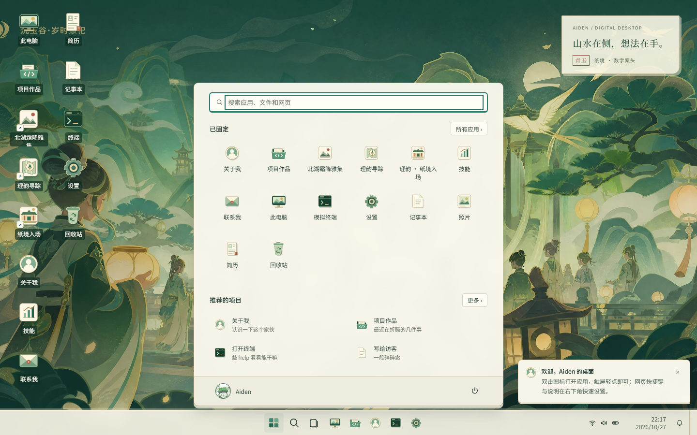
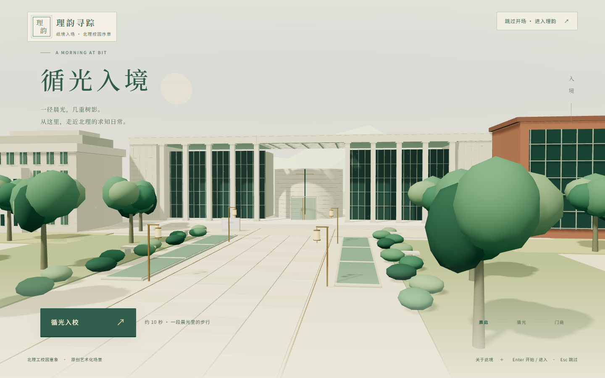

# V2 本地升级验收与交接

日期：2026-10-27（Asia/Shanghai）。基线提交 `fa9c7e2`，开始时工作区干净。**本次完成本地迁移修正、青玉纸境主页及常用桌面交互、北理工特色轻量3D校园入场；未提交、推送、部署或操作生产服务器。**

## 直接体验与启动

- [个人主页](http://127.0.0.1:8899/)
- [校园纸境入场](http://127.0.0.1:8081/)
- [理韵校园探索](http://127.0.0.1:5174/)
- [工作区健康状态](http://127.0.0.1:8899/__workspace/health)，工作区ID `528c64a060d1a96f`。

主开发服务由 [启动器](../tools/dev-workspace.mjs)管理并保留运行；仅监听127.0.0.1。临时生产预览8082/4174已在验收后停止。原5173/4173旧工程服务与8080 SSH转发未停止或复用。下次从仓库根启动：

```powershell
node tools/dev-workspace.mjs --check
node tools/dev-workspace.mjs
```

已有服务运行时使用上述地址，不重复启动。依赖已经按各应用锁文件准备；新机器仍应分别执行各应用的npm ci。实际验证环境：Node v24.22.0、npm12.2.1。

## 1. 迁移修正

- 修正旧web目录、错误启动脚本、冲突端口与默认公网联调链接，独立应用结构保留。
- 本地入口精确识别回环地址；主页两个快捷方式只打开一次，开场和目标均留在本地。生产默认域名不改变。
- Windows原子保存临时目录导致Vite监听EBUSY的问题通过临时文件忽略与200ms polling修正；之后真实HMR与连续源码更新通过。
- 素材重建脚本改显式输入、完整预检、暂存后替换；缺输入的负向测试不破坏现有13个素材/字表。已有运行素材全部通过清单校验。
- 补齐理韵favicon，修复跨项目流程捕获的404；没有放宽错误检查掩盖问题。
- QA改为原生Node WebSocket/CDP，默认隔离Edge与回环目标，不依赖全局第三方CDP包；异常、失败断言、空结果均失败退出。历史缺失证据明确标为历史，本报告链接的是本轮真实结果。

## 2. 青玉纸境个人主页

保留原生静态站与Windows式桌面，不引入新的主页框架。用户指定头像与沉玉谷壁纸已接入，原始外部文件未修改。新增本地OFL Noto字库与16个剪纸应用图标；窗口、开始菜单、设置、通知、项目页等统一玉绿/米白/柔金纸张主题，含暗色与减少动态。

### 已实现交互范围
- 锁屏/解锁、开始菜单所有应用与搜索、方向键/Enter/Escape、焦点返回。
- 桌面单选/多选/框选、双击、触屏单击、右键及键盘菜单。
- 窗口焦点/叠放、拖动、八向缩放、最小化/恢复/最大化/关闭、左右与四角贴靠、Snap布局、最大化拖回、快速操作竞态清理。
- 任务栏运行态、窗口内容预览、固定/取消固定、任务视图、显示桌面与还原原有可见窗口。
- 日历月份/今天、通知已读/清空、主题/壁纸/对齐/动效偏好持久化。
- 记事本保存/未保存提醒/UTF-8下载；网页内容目录搜索排序历史、用户明确选择的本机文本导入；照片查看和键盘切换。
- 系统级能力明确边界：终端、网络与电源均为网页功能或演示，不读取任意磁盘、不执行系统命令，不劫持Win/Alt+Tab等OS快捷键。



[暗色主题](../qa/upgrade-20261027/desktop-dark-1440.png) · [手机布局](../qa/upgrade-20261027/desktop-about-390.png) · [项目页手机底部](../qa/upgrade-20261027/projects-mobile-footer.png)

## 3. 北理工特色3D校园入场

主景以良乡文博中心的横向白框、细方柱、深青玻璃、圆鼓内庭及方格梁架为依据；侧翼提炼徐特立图书馆的浅色石格/竖窗与综合教学楼的红砖/玻璃特征。[参考来源与目视记录](BUILDING-REFERENCES.md)明确哪些是照片事实、哪些是艺术化重组。不是精确校园总平面，不使用下载照片作贴图，不暗示学校官方背书。

- 新运行路径使用原创Three.js程序几何，保留约10秒镜头步行、门庭停驻与进入过渡。
- 全程可跳过；支持暂停、键盘/触摸、减少动态、后台停止渲染、DPR/帧率上限与降档。
- WebGL不可用或contextlost时显示原创静态入口，仍可进入理韵；无自动强迫倒计时。
- 修复静态插画与3D交叉淡入叠影、深玻璃上文案不清晰、欢迎镜头裁切，以及Fast Refresh清理时强制contextloss竞争。
- 本版本静音，不请求旧游戏模型/音乐。原上游资源完整保留在源码目录，但生产产物只白名单发出必需资源和许可。
- 最终产物10个文件，共 **1,335,049字节（约1.27MiB）**，包含两份本地字库；这是落盘总量，不是首屏传输量。最终产物不含Genshin目录，源码原目录仍在。



## 4. 本轮实际验证

下面均有本轮命令/JSON/截图证据，不沿用迁移前通过数。

| 验证 | 结果与证据 |
|---|---|
| 两应用生产构建 | 均通过；[构建输出](../qa/upgrade-20261027/final-build.txt) |
| 理韵单元测试 | 13/13，三组状态/几何/时序测试 |
| 理韵浏览器回归 | [25/25](../qa/upgrade-20261027/liyun-regression.json) |
| 桌面/QA纯逻辑测试 | 9/9；URL、安全打开、存储容错、路径/断言判定 |
| 桌面DOM/API回归 | [36/36](../qa/upgrade-20261027/desktop-regression.json) |
| 桌面四尺寸输入/几何/压力 | [68/68](../qa/upgrade-20261027/desktop-matrix.json)：1440×900、1920×1080、1366×768、390×844；实际CDP鼠标/键盘/触摸输入、任务栏命中、11应用并开、暗色与减少动态 |
| 记事本实际传输 | [7/7](../qa/upgrade-20261027/note-transfer.json)：下载文件实际落盘且字节匹配，明确选择的文本导入，不执行HTML |
| 完整开场与跳过 | [2/2](../qa/upgrade-20261027/campus-flow.json)，真实到达arrival再导航至5174 |
| 主页项目快捷方式 | [2/2](../qa/upgrade-20261027/shortcuts.json)，无重复标签 |
| 场景韧性 | [16/16](../qa/upgrade-20261027/campus-resilience.json)：暂停、隐藏页、WebGL故障、contextloss、手机reduce、两次真实Fast Refresh且文件内容hash不变 |
| 生产与项目页 | [17/17](../qa/upgrade-20261027/production-check.json)：生产无QA全局、无旧游戏请求、两应用加载无404、手机项目页严格clientWidth及底部控件边界 |
| HTTP安全边界 | [12/12](../qa/upgrade-20261027/http-check.json)：公开白名单、路径穿越拒绝、Host/方法限制及工作区身份 |
| 素材失败保护 | 2/2负向输入，原13个素材/字表hash不变，资产清单校验通过 |
| QA负向自证 | [false](../qa/upgrade-20261027/negative-false.json)与[throw](../qa/upgrade-20261027/negative-throw.json)均按预期退出1 |
| 语法/差异检查 | 全部主页JS语法、TypeScript、git diff --check通过 |

首轮失败已修并重跑：任务栏托盘/时钟重叠、通知盖住窗口标题栏、独立项目页横向溢出、理韵favicon404、3D叠影/文字对比度、Windows监听与HMR竞争、QA关闭期RPC噪声。欢迎通知暂时覆盖缩放目标的测试已先通过真实点击关闭通知；测试中的异步Promise比较错误也修正后重跑，不把测试错误伪装为产品缺陷。

## 5. 验证边界与后续维护

- 浏览器证据来自隔离Edge/Chromium和CDP输入仿真。OpenCLI桥接在本轮断连后未修改用户浏览器，改用仓库隔离通道；**未做手机真机、iOS/Safari或低端GPU性能实测**。SwiftShader测试中的fps字段不是硬件性能承诺。
- WebGL不可用测试刻意注入故障；唯一预期诊断单列在expectedFaultDiagnostics。修复QA关闭状态保护后，韧性报告非预期errors均为空。
- 理韵原p5大chunk警告仍在，本次未重构其业务或打包体系；构建成功不代表该警告消失。
- 生产构建完全禁用JavaScript时，noscript保留公网部署目标；本地无JS生产预览不点击它作回环测试，DEV静态入口则指向本地。
- 头像/游戏壁纸由用户提供用于本项目，不因此成为MIT素材；公开或商业再分发须确认授权。[个人素材说明](PERSONAL-ASSETS.md)与字体OFL已附。
- 网站不是操作系统；真实文件导入只读取明确选择的文件，保存到浏览器受站点数据清理影响，下载仍由浏览器处理。
- 后续增加中文需运行[字体子集脚本](../tools/build-theme-fonts.py)。正常启动不用重建字体或音频。
- 所有更改仍在工作区，未创建提交或推送；生产发布继续遵守[所有者部署策略](../DEPLOYMENT-POLICY.md)。
