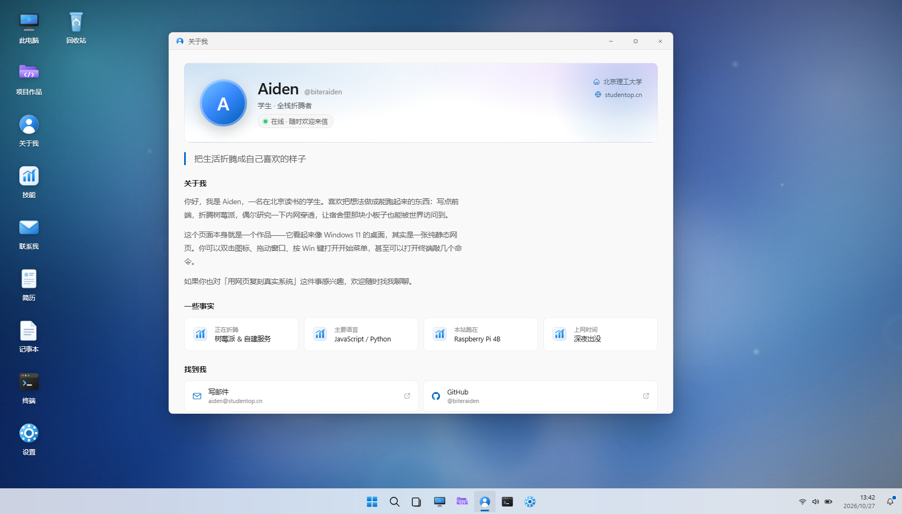

# Aiden 的个人主页 · 一个伪装成 Windows 11 的网页

> 纯静态、零依赖、无构建步骤。双击桌面图标、拖动窗口、按 Win 键打开开始菜单，都是真的能用的。
> 站点跑在树莓派 4B 上，通过 nginx + HTTPS + 浮居（frp.cool）TCP 隧道对外提供 **https://studentop.cn:14355**。



---

## 1. 目录结构

```text
win11-homepage/
├── index.html                 # 唯一入口（锁屏 + 桌面 + 任务栏 + 挂载点）
├── assets/
│   ├── css/
│   │   ├── tokens.css         # ★ 设计令牌：颜色 / 字体 / 圆角 / 阴影 / 动效（改主题先看这里）
│   │   ├── shell.css          # 外壳：壁纸 / 锁屏 / 桌面图标 / 任务栏 / 开始菜单 / 窗口 / 面板
│   │   └── apps.css           # 各个应用界面的样式
│   ├── js/
│   │   ├── icons.js           # SVG 图标库（单色 UI 图标 + 彩色应用图标）
│   │   ├── content.js         # ★ 站点内容：个人资料 / 项目 / 技能 / 联系方式 / 壁纸 / 通知
│   │   ├── core.js            # 内核：偏好 / 主题 / 时钟 / 通知 / 锁屏 / 工具函数
│   │   ├── wm.js              # 窗口管理器：拖动 / 缩放 / 最大化 / 最小化 / 贴边分屏
│   │   ├── shell.js           # 任务栏 / 开始菜单 / 搜索 / 日历通知 / 右键菜单 / 任务视图
│   │   ├── apps-about.js      # 应用：关于我 / 项目作品 / 技能 / 联系我 / 简历
│   │   ├── apps-system.js     # 应用：此电脑 / 设置 / 终端 / 记事本 / 照片 / 回收站
│   │   ├── apps.js            # 应用注册表
│   │   └── main.js            # 启动顺序 + URL 深链接
│   └── img/                   # 壁纸（2400×1350）、缩略图、favicon、og 封面
├── projects/                  # https://studentop.cn/projects/ 的项目索引页（两个外部项目的入口）
└── README.md
```

**没有框架、没有打包、没有 CDN、没有外部字体、没有统计脚本。** 浏览器打开 `index.html` 即可运行（建议用本地静态服务器，理由见第 3 节）。

---

## 2. 改内容：只改 `assets/js/content.js`

| 字段 | 作用 |
| --- | --- |
| `profile` | 名字、头像文字、身份、学校、地点、邮箱、简介、事实卡片、社交链接 |
| `projects` | 项目卡片（标题 / 副标题 / 描述 / 标签 / 年份 / 图标 / 链接） |
| `skills` | 技能分组与百分比 |
| `contact` | 联系页文案、主题卡片、表单说明 |
| `wallpapers` | 设置里可切换的壁纸列表 |
| `desktop` | 桌面图标顺序（填应用 id） |
| `taskbarPinned` | 任务栏固定应用 |
| `startPinned` | 开始菜单「已固定」应用 |
| `recommended` | 开始菜单「推荐的项目」 |
| `notifications` | 通知中心初始消息 |
| `terminalFiles` | 终端里 `ls` / `cat` 能看到的虚拟文件 |

可用的应用 id：`about` `projects` `skills` `contact` `cv` `thispc` `terminal` `notepad` `photos` `settings` `recycle`。

**快捷方式型应用**（不建窗口，双击后在新标签页打开外部站点）：`frost-atlas`（北湖霜降雅集）、`liyun-explorer`（理韵寻踪）、`genshin-start`（原神启动，开场播完自动进入理韵寻踪）。
它们的定义在 `apps-about.js` 末尾，靠 `external` 字段触发 `wm.js` 里的跳转逻辑；桌面图标会自动带快捷方式小箭头（`.desktop-icon.is-shortcut`，样式在 `shell.css`）。
改成别的外链就改 `external`；想让某个 id 出现在桌面 / 开始菜单 / 项目作品里，分别改 `content.js` 的 `desktop`、`startPinned`、`projects`。

> 改完保存、刷新浏览器即可生效，不需要构建或重启服务。

### 换头像

用自己的照片：把图片放到 `assets/img/avatar.png`，然后在 `core.js` 的 `initLock` 和 `shell.js` 的 `start-user` 里把 `<span class="avatar">` 换成 ``；或者简单点——把 `profile.avatarText` 改成 emoji（例如 `🦊`）。

### 换壁纸

壁纸由 `tools/gen_wallpapers.py`（在工作区根目录）用 Pillow 程序化生成：

```bash
python tools/gen_wallpapers.py
```

它会输出 `assets/img/wall-*.jpg`（2400×1350）和 `thumb-*.jpg`（480×270）。换配色只需要改脚本里 `make_bloom()` 等函数中的色值和参数。

---

## 3. 本地预览

在**站点目录**起一个静态服务器（注意：不要在上层工作区目录起 Python 的 http.server，那里有同名 `select.py` 会遮蔽标准库）：

```bash
cd win11-homepage
python -m http.server 8899 --bind 127.0.0.1
# 打开 http://127.0.0.1:8899/
```

也可以用 `deploy/Open-Site.cmd`（需先部署到树莓派）直接通过 SSH 隧道看线上文件。

---

## 4. 快捷键与彩蛋

| 操作 | 效果 |
| --- | --- |
| 双击桌面图标 / 单击（手机） | 打开应用 |
| 拖动标题栏 | 移动窗口；拖到屏幕边缘自动贴边分屏 |
| 双击标题栏 / 拖到屏幕顶部 | 最大化 / 还原 |
| `Win` 键（浏览器可捕获时）或 `Ctrl + Esc` | 打开开始菜单 |
| `Ctrl + K` | 打开搜索 |
| `Esc` | 关闭菜单 / 面板 |
| 终端里输入 `help` | 一堆命令：`about` `projects` `neofetch` `theme dark` `cat readme.txt` … |
| 点任务栏时钟 | 日历 + 通知中心 |
| 右键桌面 / 右键图标 | Windows 11 风格右键菜单 |
| 开始菜单电源按钮 | 锁定 / 重启 / 「关机」彩蛋 |

---

## 5. 部署（树莓派）

仓库里的 `deploy/` 目录（工作区根目录下）包含：

- `deploy-site.sh`：本地打包 → scp 上传 → 原子切换 `/opt/win11-home/current` → 自检，失败自动回滚
- `verify.sh` / `checksum-compare.sh` / `post-deploy-stats.sh`：验收、逐文件哈希比对、部署统计
- `Open-Site.ps1` / `Open-Site.cmd`：用 SSH 隧道把树莓派上的站点映射到本机 `http://127.0.0.1:8080`
- `SAKURA.md`：SakuraFrp / SakuraPanel 隧道与域名的操作步骤
- `ACME.md`：用 acme.sh 签发 `studentop.cn` 证书（DNS-01 自动 / 手动）
- `PI-STATE.md`：树莓派上的最终服务状态与回滚方法

nginx 只监听 **127.0.0.1:80（HTTP）** 与 **127.0.0.1:443（HTTPS）**，公网流量由 frpc 转发进来：

```text
浏览器 → https://studentop.cn:14355
       → 浮居节点（TCP 转发；建站1号宕机后改用北京1号 + 14355 端口）
       → frpc（树莓派，type=tcp）→ 127.0.0.1:443（nginx，Let's Encrypt 证书在树莓派上）
       → /opt/win11-home/current
```

---

## 6. 已知限制

- 终端是**假的**：命令都是前端模拟，不会真的执行 shell；这是故意的（安全）。
- 联系表单不发送请求，只是把内容拼成一封 `mailto:` 邮件。
- 回收站、磁盘容量是装饰性的演示内容。
- 窗口位置、主题、壁纸等偏好保存在 `localStorage`；清空浏览器数据会恢复默认。
- 浏览器无法真正拦截 `Win` 键（操作系统会先响应），所以额外提供了 `Ctrl + Esc`。